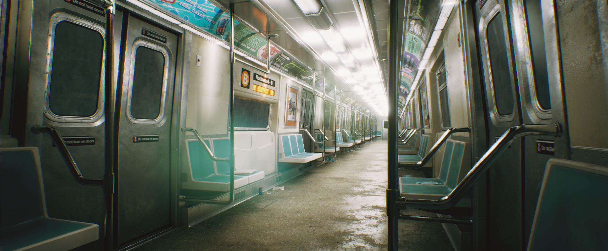
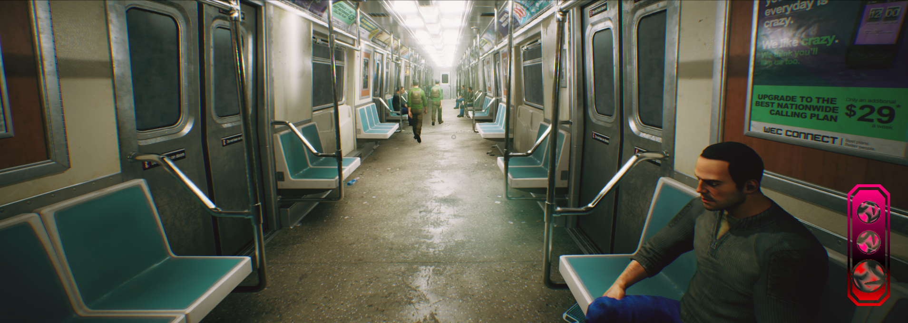
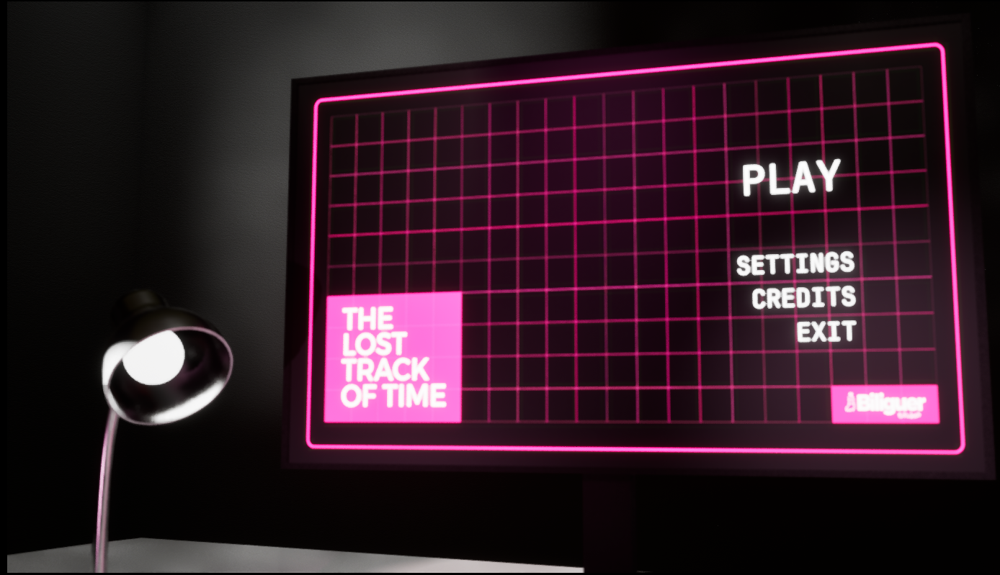

# ⏳ Viajero del Tiempo

> **Motor:** Unreal Engine 5 · **Año:** 2025 · **Tipo:** Proyecto grupal  
> **Rol:** Gameplay Programmer · **Herramientas:** Blueprints, 

---

## 🎯 Descripción

Eres un viajero del tiempo que debe ubicar a un ladrón que robó un codex de los oficiales del tiempo, para así reestructurar las líneas temporales.

## 🧠 Mi contribución

- Implementé el sistema de interacción con objetos temporales usando Blueprints.
- Programé la lógica de objetivos y el sistema de progresión.

## 📸 Capturas

